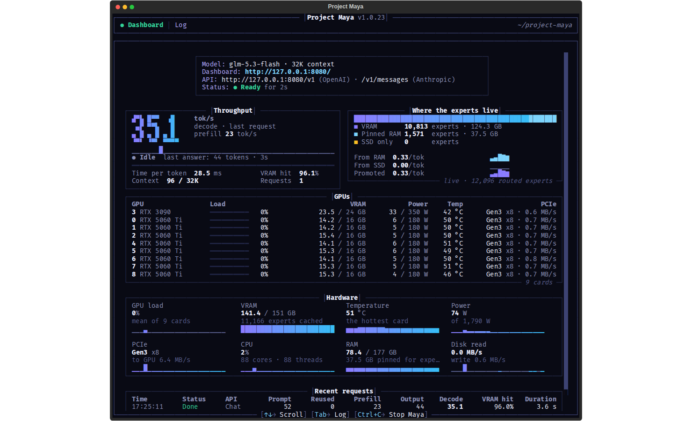

<p align="center">English | <a href="README.ja.md">日本語</a> | <a href="README.zh-CN.md">简体中文</a> | <a href="README.pt-BR.md">Português</a></p>

<p align="center"></p>

<h1 align="center">Project Maya</h1>

<p align="center"><b>GLM-5.3-Flash (321 B), DeepSeek-V4.1-Flash-1017 (748 B) and MiniMax-M3.1-Flash (428 B) on your own GPU</b><br>
private and fast · one NVIDIA GPU or up to 16 · AMD and Windows · chat, pictures, OpenAI- and
Anthropic-compatible API · several requests at once</p>

<p align="center">
<a href="https://huggingface.co/peasantsmith/GLM-5.3-Flash-Maya-GGUF"></a>
<a href="https://huggingface.co/peasantsmith/GLM-5.3-Flash-Maya-M-Derisked-IQ2_S-GGUF"></a>
<a href="https://huggingface.co/peasantsmith/DeepSeek-V4.1-Flash-1017-Maya-GGUF"></a>
<a href="https://huggingface.co/peasantsmith/MiniMax-M3.1-Flash-Maya-GGUF"></a>
</p>
<p align="center">
<a href="https://github.com/mw00/project-maya/releases"></a>
<a href="https://github.com/mw00/project-maya/actions/workflows/tests.yml"></a>
<a href="https://github.com/mw00/project-maya/blob/main/LICENSE"></a>
<a href="https://github.com/mw00/project-maya/stargazers"></a>
</p>

<p align="center">Created and led by <b>Peasant Smith</b> (<a href="https://github.com/mw00">@mw00</a>), co-maintained
with <b><a href="https://github.com/needmorevram">@needmorevram</a></b></p>

<p align="center"><a href="https://github.com/sponsors/mw00"></a>
<a href="https://buymeacoffee.com/peasantsmith"></a><br>
<sub>Project Maya is free. If it runs well on your PC, sponsoring it pays for the test hardware and the work on it.</sub></p>

Models this size usually need a datacenter. Maya runs three of them on the hardware you already have:
**GLM-5.3-Flash**, **DeepSeek-V4.1-Flash-1017** and **MiniMax-M3.1-Flash**. Each model has an engine built for it. It
keeps the experts your conversation uses most on the GPU, the next ones in RAM and the rest on your NVMe SSD, and moves
them as you chat. It measures your GPUs, CPU, RAM and SSD and tunes itself to them. Nothing leaves your machine.

## Why Maya

- **Fast:** up to 149 tokens/s on two RTX 5090s and an RTX 4090, 124 on two H100s, 118 on four RTX 4090s, 81 on one
  RTX PRO 6000, 30+ on a single RTX 5090. [Real numbers from real users](docs/benchmarks/SPEED-REPORTS.md).
- **Close to the original:** Maya's own quants of GLM-5.3-Flash keep 97.7-99.2% of the FP8 model's zero-shot
  accuracy; DeepSeek V4.1 · Maya-S picks the same next token as the original 92.6% of the time, MiniMax M3.1 · Maya-S
  87.6% (the average over its categories).
- **Plugs into your tools:** OpenAI- and Anthropic-compatible API with tool calls, ready for coding agents.
- **Several requests at once:** up to 8 answered together with GLM-5.3-Flash, DeepSeek-V4.1-Flash and
  MiniMax-M3.1-Flash - for agents that run several sessions, or several people on one PC.
- **Everything in the box:** a chat and a live monitor in the browser, pictures on every model, thinking levels, a
  Models page that downloads, loads and deletes models, a Turbo button, a one-command setup.

## What it looks like



Chat, a live monitor of each GPU's memory and the model's speed, a Models page that downloads and loads them, and
Settings - in the browser, on the machine, no cloud account. More screenshots: [Set up Maya](docs/SETUP.md).

## Quick start

```sh
git clone https://github.com/mw00/project-maya.git && cd project-maya
./setup.sh
```

The setup asks which model you want, downloads it, builds everything once and **starts the model**. Then open
`http://127.0.0.1:8080`. Windows: `START-MAYA.bat` instead of `./setup.sh`. More in [Install](#install).

## <a name="the-models"></a><a name="deepseek-v41-flash-1017-new"></a><a name="minimax-m31-flash-new"></a>Pick your model

Every Maya quant is named after its model, then its tier - XS, S, M or L, by how many bits its experts keep. The setup
recommends one for your PC; to pick one yourself, give its setup id: `./setup.sh --model glm-maya-s24`.

| Model | Maya quant · setup id | Size | Made for |
| --- | --- | ---: | --- |
| **[GLM-5.3-Flash](https://huggingface.co/zai-org/GLM-5.3-Flash)**<br><sub>zai-org · MIT · 321 B, 18 B active · up to 1M context</sub> | **Maya-S** (default) · `glm-maya-s` | 96.5 GB | PCs with a smaller memory pool (RAM and VRAM together) |
| | Maya-S24 · `glm-maya-s24` | 94.7 GB | cards of 24 GB or less: ~1.5 GB more of the card for experts, decode +14% |
| | Maya-XS · `glm-maya-xs` | 73.4 GB | PCs with 64 GB of RAM and a 24 GB card, at 128K context |
| | Maya-M · `glm-maya-m` | 116 GB | a bigger memory pool; calibrated toward tool calls and front-end code |
| | Maya-M-Derisked · `glm-maya-m-derisked` | 116 GB | Maya-M with a weight edit by [Blackfrost_AI](https://x.com/Blackfrost_AI) that reduces blanket refusals; experimental |
| | Maya-L · `glm-maya-l` | 156.3 GB | the biggest memory pools; the closest to the original |
| **[DeepSeek-V4.1-Flash-1017](https://huggingface.co/deepseek-ai/DeepSeek-V4.1-Flash-1017)**<br><sub>DeepSeek · MIT · 748 B</sub> | **Maya-S** (default) · `deepseek-maya-s` | 340 GB | any amount of memory: what VRAM and RAM don't hold is read from the SSD |
| | Maya-XS (v2) · `deepseek-maya-xs` | 277 GB | the whole model in a 128 GB PC's memory (the Engram tables stay on the SSD); v2 is about 12% closer to the original and about 20% faster at writing than v1 - running the setup again offers the update |
| **[MiniMax-M3.1-Flash](https://huggingface.co/MiniMaxAI/MiniMax-M3.1-Flash)**<br><sub>MiniMax · [MiniMax Community License](licenses/LICENSE.minimax-m31) · 428 B, 23 B active · up to 1M context</sub> | Maya-XS · `minimax-maya-xs` | 93 GB | the whole model in a 128 GB PC's memory |
| | Maya-S · `minimax-maya-s` | 122 GB | closer to the original |

All of them run on NVIDIA from the V100 / RTX 20 on, and on AMD and Windows (see
[What you need](#what-you-need)). DeepSeek's sizes include its Engram tables. The setup also offers unsloth's GGUF and
LibertAIDAI's EXL3 quants of DeepSeek, orcarouter's abliterated DeepSeek, Mia-AiLab's EXL3 quant of MiniMax,
turboderp's EXL3 quants of GLM, Qwen-3.8-Flash-Next (CYBER-FROST) as its Q5_K_M GGUF and Qwen-3.8-Flash-Next
itself as unsloth's UD-IQ2_XS GGUF, both with pictures
([its settings](docs/SETTINGS.md#qwen-38-flash-next-cyber-frost)). **Each model's files, drafters, pictures and options:
[docs/MODELS.md](docs/MODELS.md).**

## Quality

Maya's quants are made from each model's released weights and measured against the original:

- **GLM-5.3 · Maya quants** keep 97.7-99.2% of the FP8 model's zero-shot accuracy and pick its next token 83-90% of
  the time (Maya-L: 99.2%, 90%). How they're made and measured: [MAYA-S](docs/benchmarks/results/MAYA-S.md),
  [MAYA-S24](docs/benchmarks/results/MAYA-S24.md), [MAYA-M](docs/benchmarks/results/MAYA-M.md), [MAYA-L](docs/benchmarks/results/MAYA-L.md).
- **DeepSeek V4.1 · Maya-S** picks the same next token as the original 92.6% of the time.
- **MiniMax M3.1 · Maya-S** picks it 87.6% of the time (the average over its categories).

More on each model's card on [Hugging Face](https://huggingface.co/peasantsmith).

## How fast is it?

Real machines measured by our users, most with `./maya.sh --bench` (decode: three greedy 256-token answers; prefill:
an 8K-token prompt unless the row says otherwise). The full table - three model families, every quant, every machine -
is in **[speed reports](docs/benchmarks/SPEED-REPORTS.md)**. Share yours: `--bench`, then `--report`, in a
[GitHub issue](https://github.com/mw00/project-maya/issues/new/choose).

| Machine | Model | Decode | Prefill | By |
| --- | --- | ---: | ---: | --- |
| **8x RTX 5090 32 GB**, Xeon Gold 6530, 1 TB RAM | DeepSeek-V4.1 Maya-S, 512K, `--parallel 4` | **184.2 tokens/s** | 2510 tokens/s | @etevrfed34-commits (v1.1.34, #585) |
| **2x RTX 5090 32 GB + RTX 4090 48 GB**, Core i7-13700K, 188 GB RAM | GLM-5.3 Maya-S / Maya-M-Derisked, 32K | **148.6 / 123.4 tokens/s** | 2605 / 2341 tokens/s | @prismaillya17 (v1.1.26, #498) |
| **2x H100 80 GB**, Xeon Platinum 8488C, 504 GB RAM | GLM-5.3 Maya-L / Maya-M-Derisked, 1M | **122.4 / 123.7 tokens/s** | 2099 / 1986 tokens/s | @Molyleaf (v1.1.11, #258, #259) |
| **4x RTX 4090 24 GB**, Xeon w7-3445, 62 GB RAM | GLM-5.3 Maya-S24 | **118 tokens/s** | 4129 tokens/s | @0xPreDa (v1.0.31, #89) |
| **8x RTX 3090 24 GB**, EPYC 7402P, 126 GB RAM | GLM-5.3 EXL3-4.05bpw, 1M | **117.4 tokens/s** | 1470 tokens/s | @MarkMakers (v1.1.15, #414) |
| **2x A100-SXM4 80 GB**, Xeon Platinum 8360Y, 1 TB RAM | DeepSeek-V4.1 Maya-S, 1M | **87.4 tokens/s** | 2084 tokens/s | @SunYong0821 (v1.1.34, #445, #594) |
| **RTX PRO 6000 Blackwell 96 GB**, Ryzen 7 9800X3D, 61 GB RAM | GLM-5.3 Maya-M, 256K | **81.0 tokens/s** | 3102 tokens/s | @yundddd (v1.1.7, #172) |
| **4x Tesla V100 32 GB**, 2x Xeon E5-2630 v4, 126 GB RAM | GLM-5.3 Maya-S / M / L, 32K | **69.7 / 67.2 / 43.3 tokens/s** | 730 / 713 / 627 tokens/s | @HansStrupat (v1.1.36, #327, #340, #653) |
| **2x RX 7900 XTX 24 GB + Radeon 8060S** helper, 128 GB | GLM-5.3 Maya-M, 512K | **56.0 tokens/s** | 907 tokens/s (114K) | @pepuscz (v1.1.25, #454-#458) |
| **RTX PRO 6000 Blackwell 96 GB**, Ryzen 9 9950X3D, 253 GB RAM | MiniMax-M3.1 Maya-S, 256K | **48.6 tokens/s** | 757 tokens/s | @Andrey0710 (v1.1.43, #738) |
| **RTX 5090 32 GB**, Ryzen 9 7950X, 96 GB DDR5 | GLM-5.3 Maya-M | **30+ tokens/s** | ~2000 tokens/s | @siganos (#43) |
| **RTX 4090 24 GB**, Ryzen 9 9950X3D, 192 GB DDR5 | GLM-5.3 Maya-S24, 32K | **25.7 tokens/s** | 1963 tokens/s | @oscarlius (v1.1.24, #420) |
| **NVIDIA DGX Spark** (GB10, 121 GB unified) | GLM-5.3 Maya-S, 128K | **16.5 tokens/s** | ~730 tokens/s | @ericoh88 (v1.1.15, #282) |

A token is about three quarters of a word. Speed holds as a conversation grows; the first answers after a start are the
slowest while the caches fill with what you use.

## Using it

- **In the browser:** chat (kept in your browser, with search, pins and folders, per-chat instructions and thinking
  level, edit and regenerate, HTML previews), a live **Monitor** of the model and your hardware (down to what fills
  each GPU's memory), a context size and port you can change in Settings, and **Models**: every model set up on this
  machine, switching to another (Maya starts again with it) and each one's engine settings (context, GPUs, drafting,
  images, memory), saved into its `maya-<model>.json`.
- **Models page:** the catalog lists every Maya model with its size. Download one with a progress bar, load it, unload
  the running one or delete one - no command line needed.
- **Turbo:** one button beside the model's parameters sets the fastest settings for the model (greedy sampling, no
  thinking, expert skipping, the fastest drafting). It trades some quality for speed; switching it off restores your
  settings exactly.
- **Saved:** the sidebar's Saved line adds up what the model's own API (DeepSeek's, Z.ai's or MiniMax's) would have
  charged for the same tokens - the prompt Maya reuses from its cache at the API's cached price, DeepSeek's peak hours
  at its peak price - kept per model in `token-savings.json`; its prices can be changed in **Settings › Savings**.
- **Your apps and coding agents:** an OpenAI-compatible API at `http://127.0.0.1:8080/v1`, and Anthropic's at
  `http://127.0.0.1:8080/v1/messages` (Claude Code: `ANTHROPIC_BASE_URL=http://127.0.0.1:8080`). Tool calls are
  streamed as the model writes them, and a long prompt's reading progress too when a request asks for it
  (`"return_progress": true`). A web page served from another address can call it too once you allow its address
  (`"cors_origins"`, [docs/SETUP.md](docs/SETUP.md#web-pages-on-another-address)).
- **Responses API:** `/v1/responses` supports text/image conversations, streaming, function tool calls,
  schema-validated output, background tasks with cancellation/replay, and optional shared in-memory history
  (`store:true`, `previous_response_id`). Responses are not stored by default. Options and limits:
  [docs/RESPONSES.md](docs/RESPONSES.md).
- **Model API:** `/api/tags`, `/api/ps`, `/api/show`, `/api/chat`, `/api/generate`, `/api/pull` and `/api/delete` list,
  load, download and delete models from any app or script. A request for a model that is not loaded swaps to it, and
  `keep_alive` unloads it when idle. `/models/load`, `/models/unload` and `/models/sse` are on by default too
  (`"model_management": false` turns them off).
- **Thinking:** Off, Low, High (the default) or Max, in Settings or per request, and a **thinking budget** field that
  sets how many tokens the model may think before it answers.
- **Loop guard:** on by default - an agent that repeats the same tool call with the same result is steered off it.
- **Pictures:** attach one in the chat, or send image parts through either API. Every model reads them (setup details per
  model: [docs/MODELS.md](docs/MODELS.md)).
- **From another device:** `./maya.sh --setup --host 0.0.0.0 --api-key <secret>`. Always set a key.
- **Tuning:** `./maya.sh --calibrate` tunes the engine to your hardware in 10-15 minutes. Every setting:
  [docs/SETTINGS.md](docs/SETTINGS.md).
- <a name="deepseek-engram-prompt-read-ahead"></a><a name="deepseek-conversations-kept"></a><a name="deepseek-loading-the-experts"></a>**Each model's own options** - GLM-5.3-Flash's several requests at once (`--parallel`), long contexts and DFlash2
  drafter; DeepSeek's kept conversations, expert loading and Engram read-ahead; MiniMax's thinking levels:
  [docs/MODELS.md](docs/MODELS.md).

## What you need

| | |
| --- | --- |
| **GPU** | NVIDIA, compute capability 7.0 or newer (V100, RTX 20 and newer): one, or up to 16 that share the model. More VRAM is faster. Pascal (Tesla P40 / P100, GTX 10) is experimental, not validated yet. **AMD:** RX 7900 XT / XTX, Radeon AI PRO R9700 / RX 9070, Strix Halo and Gorgon Halo (Radeon 8060S / 8065S); RX 6800 / 6900 and Radeon PRO V620 / W6800 not validated yet; GLM-5.3-Flash and DeepSeek-V4.1-Flash-1017 read pictures there too - [docs/AMD_MAYA.md](docs/AMD_MAYA.md) |
| **RAM** | 32 GB runs it. More RAM keeps more experts close and is faster |
| **Disk** | **A fast NVMe SSD** with room for the model (~75 GB for GLM-5.3 · Maya-XS, ~100 GB for GLM-5.3 · Maya-S, ~160 GB for GLM-5.3 · Maya-L, ~350 GB for DeepSeek V4.1 · Maya-S, ~470 GB for unsloth's Q8 GGUF of it, ~95 GB for MiniMax M3.1 · Maya-XS, ~200 GB for MiniMax-M3.1-Flash's EXL3 quant) and its picture encoder (1.1 GB). Not a hard disk |
| **System** | Linux (x86-64; a CPU with AVX2 is best), the NVIDIA driver, CUDA 12.x (CUDA 13 works for RTX 20 and newer, not for the V100 or Pascal), g++, Python 3.10+. Windows 10/11: [docs/WINDOWS.md](docs/WINDOWS.md). Not WSL2. AMD: ROCm 7 |

The setup checks all of this, prints the exact command for anything missing, and installs nothing system-wide.

## Install

Run the two commands in [Quick start](#quick-start) and answer a few questions (Enter takes the recommended choice).
The setup shows every download before it starts it, builds everything once (20-40 minutes plus the download) and
**starts the model**. Then open `http://127.0.0.1:8080`. Ctrl+C stops it, and `./setup.sh` starts it again right away.

- **Windows:** `START-MAYA.bat` instead of `./setup.sh` - see [docs/WINDOWS.md](docs/WINDOWS.md).
- **AMD:** [docs/AMD_MAYA.md](docs/AMD_MAYA.md).
- **Mac with Apple Silicon (experimental, GLM-5.3-Flash only):** `./maya.sh --backend metal` (on a Mac, `./maya.sh`
  picks Metal by itself) - see [docs/METAL.md](docs/METAL.md). Built and unit-tested on GitHub's Macs, not yet tested
  by us with the real model (we have no Mac): if you run it, please tell us how it went in an issue.
- **Intel Arc:** not supported by Maya's engine; a community report of the Maya-XS DeepSeek GGUFs on llama.cpp's SYCL backend: [docs/INTEL_ARC.md](docs/INTEL_ARC.md).
- **Updating:** the page's **Settings › About and updates**, or `git pull` then `./setup.sh`. The model isn't downloaded again.
- **Model files downloaded another way** (a download manager, another PC, a Hugging Face cache): `./maya.sh --import-model FOLDER`
  finds Maya's files in FOLDER by size and checksum, whatever they are called, and moves them into place (`--copy` when
  FOLDER is on another drive; the originals stay). Files that do not match are left alone.
- **Every option** (GPUs, context, a model folder you already have, remote access, ...): [docs/SETUP.md](docs/SETUP.md).

> **The start takes a few minutes:** the engine pins most of the free RAM (all but about 6 GB) for its expert tier,
> so other programs get little RAM while Maya runs.

## Something went wrong?

Run **`./maya.sh --report`** (Windows: `START-MAYA.bat --report`) right after a slow answer or an error, and attach the
`maya-report.txt` it writes to a [GitHub issue](https://github.com/mw00/project-maya/issues). It holds your hardware,
your setup and the engine's speed lines; nothing is sent anywhere by itself. The engine's own log is
`maya-<model>.log` in the Maya folder.

- **The build stops** ("nvcc ... cannot build for these GPUs", "unsupported GNU version", or `cuda_profiler_api.h` /
  `nvtx3/nvToolsExt.h` missing): [docs/SETUP.md](docs/SETUP.md#if-the-build-fails) has the fix for each.
- **Slow, with the SSD busy all the time:** not enough free RAM for the experts. Close programs or add RAM.
- **Windows: answers suddenly several times slower:** the card is too full and Windows moves GPU memory to RAM. Leave
  more of it free: `START-MAYA.bat --setup --vram-reserve-mib 2048`
  ([the expert pool's size](docs/SETTINGS.md#the-expert-pools-size)).
- **Windows on a Strix Halo / Gorgon Halo: other programs run out of memory, or the setup warns about the page
  file:** set the page file to the size the setup prints ([docs/AMD_MAYA.md](docs/AMD_MAYA.md)).
- **The download stopped:** run `./maya.sh` again; it continues where it stopped.
- **Port 8080 is in use:** Maya is already running, or `--port 8081` starts another one. Settings > Port moves Maya to
  another port for good (it starts again there).

## Docs

| Start here | Use it | Platforms | Reference |
| --- | --- | --- | --- |
| [Set up Maya](docs/SETUP.md) | [Settings](docs/SETTINGS.md) | [Windows](docs/WINDOWS.md) | [Models](docs/MODELS.md) |
| [Compatibility](docs/COMPATIBILITY.md) | [Responses API](docs/RESPONSES.md) | [AMD / ROCm](docs/AMD_MAYA.md) | [Speed reports](docs/benchmarks/SPEED-REPORTS.md) |
| [FAQ](docs/FAQ.md) | [Troubleshooting](#something-went-wrong) | [Apple Metal](docs/METAL.md) | [Quant results](docs/benchmarks/results/) |

Everything else, including the engineering notes: **[documentation index](docs/README.md)**.

## Support

Maya is free and open source, and it always will be. It exists so that anyone can run the biggest open models at home,
on hardware they already own. Sponsors make that possible:

- **More hardware runs well.** Every release is tested on our own NVIDIA and AMD machines before it ships. Macs are so
  far tested only on GitHub's virtual Macs. The current goal is 50 monthly sponsors, enough for a real Mac and newer
  GPUs.
- **New models sooner.** Every new model and quant takes many hours of GPU time to build and check.
- **Faster fixes** when something breaks on your setup.

If you enjoy running big models on your own machine, a small monthly sponsorship is the best way to keep Maya growing.
Thank you!

<p align="center"><a href="https://github.com/sponsors/mw00"></a>
<a href="https://buymeacoffee.com/peasantsmith"></a></p>

Speed reports, bug reports and pull requests are welcome: [CONTRIBUTING.md](CONTRIBUTING.md) says what helps most.

## Credits and license

- **People:** Project Maya is created and led by Peasant Smith ([@mw00](https://github.com/mw00),
  [X](https://x.com/PeasantSmith)), who owns the project, its name and the Maya models.
  [@needmorevram](https://github.com/needmorevram) ([X](https://x.com/needmorevram)) is a co-maintainer and
  contributed major features: DFlash2 drafting, EXL3 support, KV streaming,
  conversation checkpoints, the layer-split search, the expert profile and the CPU expert kernels, and for
  `maya-ds4` the 3.5-bit EXL3 option, tensor parallel over 4 / 8 GPUs and the threaded expert-cache swaps (#276). Thanks also to everyone who sent code and speed reports
  ([contributors](https://github.com/mw00/project-maya/graphs/contributors)).
- **Built on [ggml / llama.cpp](https://github.com/ggml-org/llama.cpp)** (MIT License, Copyright (c) 2023-2026 The ggml
  authors): the quantization formats, the CPU dot products and the prompt path's MMQ kernels, built from a pinned
  commit (`third_party/ggml/LICENSE`).
- **EXL3 support** follows [exllamav3](https://github.com/turboderp-org/exllamav3)'s format, codebooks, CPU expert
  kernel and tensor-core decoding of a tile (MIT License, Copyright (c) 2025 Turboderp; `third_party/exllamav3/LICENSE`). **The DFlash2 drafter's
  forward** follows [beellama.cpp](https://github.com/Anbeeld/beellama.cpp)'s (MIT License, Copyright (c) 2023-2026
  The ggml authors, Anbeeld; `third_party/beellama.cpp/LICENSE`).
- The models: [GLM-5.3-Flash](https://huggingface.co/zai-org/GLM-5.3-Flash) by zai-org (MIT); Maya's quants and the
  image encoder file are made from zai-org's released weights and keep its license.
  [DeepSeek-V4.1-Flash-1017](https://huggingface.co/deepseek-ai/DeepSeek-V4.1-Flash-1017) by DeepSeek (MIT); Maya's
  quant, its Engram tables and the drafter are made from DeepSeek's released weights and keep its license; the vision
  tower comes from DeepSeek's checkpoint, the GGUF option from
  [unsloth's GGUFs](https://huggingface.co/unsloth/DeepSeek-V4.1-Flash-1017-GGUF), the EXL3 options are
  LibertAIDAI's ([2.9](https://huggingface.co/LibertAIDAI/DeepSeek-V4.1-Flash-1017-EXL3-2.9bpw) and
  [3.5 bpw](https://huggingface.co/LibertAIDAI/DeepSeek-V4.1-Flash-1017-EXL3-3.5bpw)). The optional DFlash2 drafter
  ([GLM-5.3-Flash-DFlash2-GGUF](https://huggingface.co/Anbeeld/GLM-5.3-Flash-DFlash2-GGUF) by Anbeeld) is CC BY-NC-ND
  4.0, non-commercial use only, and is downloaded only when you choose it.
- The dashboard's font: Outfit (SIL Open Font License 1.1, `serve/web/fonts/OFL.txt`); its icons:
  [Lucide](https://lucide.dev) (ISC License, `serve/web/LICENSE.lucide.txt`); its UI library:
  [Preact](https://preactjs.com) (MIT License) with [htm](https://github.com/developit/htm) (Apache License 2.0),
  bundled in `serve/web/preact.js` with their notices.
- Maya is open source under the [MIT License](LICENSE); the notices in [LICENSE](LICENSE), [THIRD_PARTY_NOTICES.md](THIRD_PARTY_NOTICES.md) and `third_party/` stay
  with every copy.
